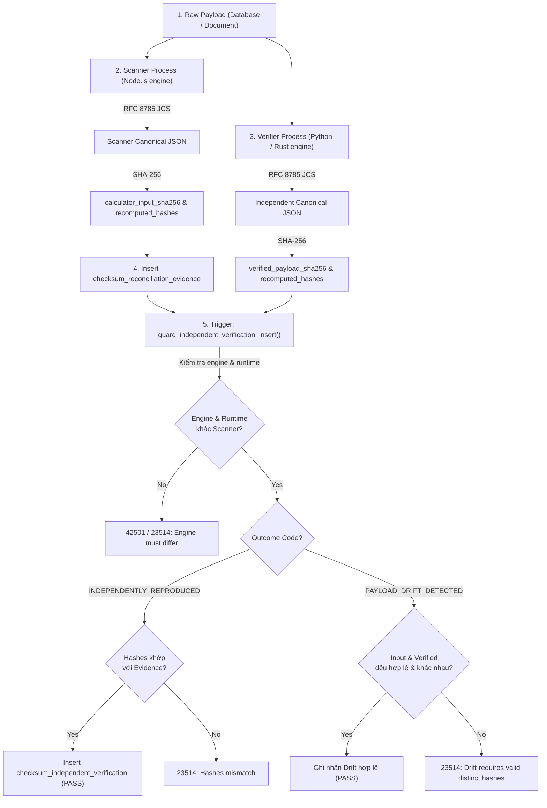

# R20-05 — INDEPENDENT TECHNICAL VERIFICATION FLOW & TRUST EVALUATION
## Dự án: Unified Legal Hub (ULH) — TASK-003 Staging Acceptance
## Nhiệm vụ: ULH-EXEC-020

---

## 1. Mục Tiêu & Bản Chất Của Kiểm Minh Kỹ Thuật Độc Lập

Trong mô hình hệ thống một người dùng chính của ULH, mục tiêu bảo mật không đặt vào việc phân tách nhiều con người kiểm soát lẫn nhau (Four-Eyes human separation), mà tập trung vào **tính độc lập kỹ thuật thực chất (Technical Independence)**:
- Quá trình xác minh (Verifier) phải chạy bằng một tiến trình / engine khác với tiến trình đối soát ban đầu (Scanner).
- Verifier không được phép chỉ nhận checksum tính sẵn từ Scanner rồi đóng dấu PASS, mà bắt buộc phải nhận payload đầu vào, tự thực hiện lại toàn bộ thuật toán chuẩn hóa canonicalization (RFC 8785 JCS) và tính toán lại digest SHA-256.
- Kết quả đối soát phải được gắn kết 1-đối-1 với sự kiện kiểm toán hệ thống bất biến (`system_audit_event`).

---

## 2. Truy Nguyên Luồng Dữ Liệu Toàn Diện (End-to-End Data Flow)

---

## 3. Đánh Giá Khả Năng Chống Giả Mạo & Giới Hạn Của Metadata Engine

### A. Cơ chế kiểm soát tại tầng cơ sở dữ liệu:
1. **Kiểm tra định danh động cơ:** Trigger bắt buộc `NEW.verifier_engine_id <> v_ev.calculator_engine_id` và `NEW.verifier_runtime_family <> v_ev.calculator_runtime_family`.
2. **Kiểm tra toán học:** Bắt buộc đối chiếu 1-đối-1 từng thuật toán trong `tested_algorithms` với các mã băm 64-hex SHA-256 trong `recomputed_hashes`.
3. **Kiểm tra tính bất biến:** Bảng `checksum_independent_verification` được bảo vệ bằng trigger `reject_immutable_change()` ngăn chặn tuyệt đối mọi hành vi `UPDATE`, `DELETE` hoặc `TRUNCATE` (SQLSTATE `55000`).

### B. Giới hạn tin cậy (Trust Boundary Limitation & Anti-Spoofing):
- Cơ sở dữ liệu PostgreSQL chỉ có thể kiểm tra các chuỗi metadata được truyền vào câu lệnh SQL (`verifier_engine_id`, `verifier_runtime_family`).
- **Phát hiện kiểm toán:** Nếu một client có quyền truy cập gửi metadata giả mạo (ví dụ: client Node.js tự điền `verifier_runtime_family = 'PYTHON'` và copy nguyên vẹn kết quả của Scanner), cơ sở dữ liệu **không thể** xác thực bằng mật mã xem code Python có thực sự chạy trên môi trường vật lý hay không (trừ khi áp dụng bằng chứng thực thi mật mã như cryptographic hardware attestation hoặc chữ ký số từ keypair riêng của container Verifier).
- **Biện pháp kiểm soát kiến trúc:** Dịch vụ Verifier phải được triển khai như một background daemon độc lập, sử dụng credentials/role riêng biệt (`ulh_reconciler` vs `ulh_verifier`) để bảo đảm việc phân tách tiến trình ở cấp hệ điều hành.

---

## 4. Kết Quả Kiểm Thử Thực Tế (10/10 Test Cases)

| Mã test | Tên ca thử nghiệm | Mã lỗi thực tế | Trạng thái |
|:---:|---|:---:|:---:|
| **TC-01** | Xác minh độc lập hợp lệ tính ra hash trùng khớp | `00000` | **PASS** |
| **TC-02** | Phát hiện Payload Drift hợp lệ (hai hash 64-hex khác nhau) | `00000` | **PASS** |
| **TC-03** | Chặn Payload Drift khi hash xác minh trùng với input hash | `23514` | **PASS** |
| **TC-04** | Chặn Payload Drift khi hash xác minh bị NULL | `23514` | **PASS** |
| **TC-05** | Chặn thuật toán không hợp lệ trong `tested_algorithms` | `23514` | **PASS** |
| **TC-06** | Chặn khi `recomputed_hashes` không khớp với bằng chứng | `23514` | **PASS** |
| **TC-07** | Chặn khi `verifier_engine_id` trùng với scanner | `23514` | **PASS** |
| **TC-08** | Chặn khi `verifier_runtime_family` trùng với scanner (`NODE_JS`) | `23514` | **PASS** |
| **TC-09** | Chặn khi thiếu transaction authentication context | `42501` | **PASS** |
| **TC-10** | Chặn hành vi sửa đổi bản ghi xác minh độc lập đã lưu | `55000` | **PASS** |

**Đánh giá tiêu chí R20-05:** `PASS`.
