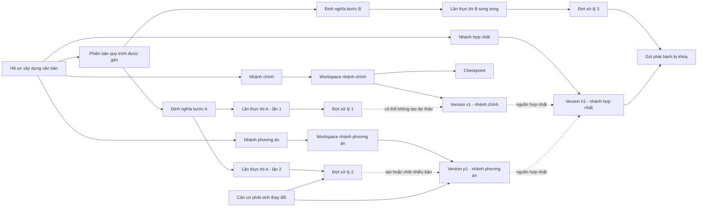

# Mô hình nghiệp vụ tổng thể

## 1. Mục đích và phạm vi

Tài liệu xác lập mô hình nghiệp vụ nền tảng, độc lập với một quy trình pháp luật cụ thể. Phạm vi sản phẩm được xác định tại [Phạm vi sản phẩm - phiên bản 1](../01-pham-vi-san-pham/pham-vi-phien-ban-1.md); quy tắc cấu hình tại [Nguyên tắc workflow](../04-thiet-ke-quy-trinh/nguyen-tac-workflow.md); và thuật ngữ dữ liệu tại [Từ điển thực thể nghiệp vụ](../05-mo-hinh-du-lieu/tu-dien-thuc-the-nghiep-vu.md).

Tài liệu `private-data/input/Quy trình Cục.pdf` lập tháng 10/2025 chỉ là nguồn tham chiếu để nhận diện tình huống nghiệp vụ. Tài liệu này không được coi mặc nhiên là quy trình pháp luật hiện hành; các căn cứ, thời hạn, thành phần hồ sơ và thẩm quyền nêu trong đó phải được kiểm chứng trước khi cấu hình sử dụng.

## 2. Bốn lớp nghiệp vụ

### 2.1. Hồ sơ xây dựng văn bản

Hồ sơ là không gian quản lý trọn vòng đời một sáng kiến xây dựng văn bản mới hoặc sửa đổi, bổ sung văn bản hiện hành. Hồ sơ chứa mục tiêu, loại văn bản, cơ quan chủ trì, người tham gia, phiên bản quy trình được gán, các đợt xử lý, các nhánh dự thảo, gói phát hành và nhật ký kiểm toán.

Hồ sơ tồn tại xuyên suốt các lần quay lại bước trước và không bị tách thành hồ sơ mới chỉ vì có thêm vòng góp ý hoặc dự thảo.

### 2.2. Giai đoạn hoặc bước quy trình

Giai đoạn/bước biểu diễn nghĩa vụ phải thực hiện, cổng kiểm soát và điều kiện chuyển trạng thái theo một phiên bản quy trình. Bước không phải là phiên bản dự thảo và không sở hữu một số thứ tự dự thảo cố định.

Một bước có thể lặp lại, được quay lại hoặc chạy song song với bước khác nếu cấu hình cho phép. Một hồ sơ đang thực hiện giữ phiên bản quy trình đã được gán, trừ khi có quyết định chuyển đổi được ghi nhận.

Mỗi lần một bước được kích hoạt tạo một lần thực thi bước (`WorkflowStageInstance`) riêng, có thời điểm bắt đầu/kết thúc, trạng thái, người phụ trách, kết quả cổng và nguyên nhân quay lại. Vì vậy cùng một bước có thể có nhiều lần thực thi nối tiếp hoặc song song mà không làm thay đổi định nghĩa bước.

### 2.3. Đợt xử lý

Đợt xử lý (`ReviewRound`) là một lần nghiệp vụ có mục đích và ranh giới rõ, ví dụ một đợt lấy ý kiến, một cuộc họp, một chỉ đạo, một lần chỉnh lý, một lần trình hoặc một lần thẩm định. Đợt xử lý ghi nhận đầu vào, người tham gia, thời gian, kết quả, kết luận và liên kết đến tài liệu liên quan.

Một lần thực thi bước có thể chứa không, một hoặc nhiều đợt xử lý. `ReviewRound` không thay thế `WorkflowStageInstance`: lần thực thi bước theo dõi trạng thái và cổng của workflow, còn đợt xử lý ghi một hoạt động nghiệp vụ cụ thể. Một bước có không giới hạn số lần thực thi và số đợt xử lý. Một đợt có thể không tạo dự thảo mới nếu kết luận giữ nguyên; hoặc có thể tạo nhiều mốc làm việc trước khi chốt một hay nhiều phiên bản dự thảo đầu ra.

### 2.4. Phiên bản dự thảo

Mỗi nhánh có một trạng thái biên tập đang hoạt động (`DraftWorkspace`) và có thể có nhiều mốc khôi phục (`DraftCheckpoint`). Tự động lưu chỉ cập nhật trạng thái làm việc hoặc tạo checkpoint theo chính sách, không mặc nhiên tạo phiên bản dự thảo.

Phiên bản dự thảo (`DraftVersion`) là mốc nội dung bất biến có định danh, được người dùng tạo chính thức từ `DraftWorkspace` hoặc từ việc hợp nhất các phiên bản thuộc những nhánh khác nhau. Phiên bản ghi rõ nhánh sở hữu, phiên bản cha hoặc các phiên bản nguồn hợp nhất, người chốt, thời điểm, lý do và tập thay đổi pháp lý.

Mỗi phiên bản có một hoặc nhiều liên kết căn cứ tạo phiên bản (`DraftVersionBasis`). Liên kết ghi loại căn cứ, nguồn nghiệp vụ hoặc `SourceDocument`, vai trò của căn cứ và ghi chú tại thời điểm chốt; không đồng nhất với `LegalBasis`, vốn quản lý căn cứ pháp lý theo nguồn và hiệu lực. Mã phiên bản được cấp tuần tự trong phạm vi cấu hình, không được sửa hoặc tái sử dụng sau khi đã cấp.

Bước quy trình và phiên bản dự thảo là hai trục độc lập: một dự thảo có thể đi qua nhiều đợt/bước; một bước có thể tham chiếu nhiều dự thảo hoặc không tạo dự thảo nào.

Sơ đồ thể hiện hai trục song song: quy trình/lần thực thi/đợt xử lý và nội dung/nhánh/workspace/phiên bản. Mỗi phiên bản thuộc đúng một nhánh; phiên bản hợp nhất mới thuộc nhánh hợp nhất và truy nguyên các phiên bản nguồn. Liên kết giữa hai trục là quan hệ truy nguyên, không phải quan hệ một-một.

## 3. Vòng lặp tại cấp Cục và cấp Bộ

Ở cấp Cục có thể có nhiều vòng góp ý, họp, chỉ đạo và chỉnh lý trước khi trình Bộ. Mỗi vòng là một đợt xử lý độc lập, có thể dùng lại cùng phiên bản dự thảo, tạo phiên bản mới hoặc tạo nhánh phương án.

Ở cấp Bộ có thể phát sinh nhiều vòng tương tự trước khi thẩm định hoặc trình ký. Việc hồ sơ đã được trình Bộ không làm đóng trục dự thảo; mọi lần trả lại, chỉ đạo hoặc tiếp thu tiếp theo tiếp tục được ghi trong cùng hồ sơ.

Không đặt giới hạn nghiệp vụ về số vòng hoặc số phiên bản. Giới hạn kỹ thuật về dung lượng, lưu trữ và lưu giữ hồ sơ, nếu có, phải được xác định riêng và không được làm mất lịch sử bắt buộc.

## 4. Các cấp độ tài liệu nội dung

| Cấp độ | Ý nghĩa | Khả năng sửa | Quy tắc chính |
| --- | --- | --- | --- |
| Không gian biên tập (`DraftWorkspace`) | Trạng thái biên tập hiện hành của một nhánh | Được sửa theo quyền | Mỗi nhánh có tối đa một workspace hoạt động; tự động lưu không tạo phiên bản |
| Mốc khôi phục (`DraftCheckpoint`) | Ảnh chụp tự động hoặc thủ công để phục hồi trạng thái biên tập | Không sửa; có thể dùng để khôi phục workspace | Không phải phiên bản chính thức; mọi lần khôi phục phải có nhật ký kiểm toán |
| Phiên bản dự thảo (`DraftVersion`) | Mốc nội dung chính thức được tạo từ workspace hoặc hợp nhất | Bất biến; thay đổi tạo phiên bản mới | Có định danh, một nhánh sở hữu, phiên bản cha/nguồn hợp nhất và lý do chốt |
| Bản phát hành | Bản đã gửi lấy ý kiến, trình, thẩm định, phê duyệt hoặc công bố | Bị khóa | Gắn với gói phát hành, người phát hành, thời điểm, đối tượng nhận và dấu vết tài liệu sinh ra |

`ReleasePackage` chỉ nhận `DraftVersion`, không nhận trực tiếp `DraftWorkspace` hoặc `DraftCheckpoint`. Bản đã phát hành để lấy ý kiến hoặc trình phải được khóa. Sửa nội dung hoặc thành phần sau phát hành phải tạo phiên bản/gói phát hành mới; bản cũ vẫn được giữ để đối chiếu.

## 5. Nhánh dự thảo và hợp nhất

Hồ sơ có thể tồn tại nhiều phương án dự thảo song song, mỗi phương án thuộc một nhánh và có mục đích rõ. Việc hợp nhất phải ghi:

- các phiên bản nguồn;
- nội dung được chọn hoặc loại bỏ;
- người thực hiện và người quyết định;
- căn cứ của từng thay đổi quan trọng;
- xung đột còn mở, nếu có.

Hợp nhất tạo phiên bản mới thuộc một nhánh đích và truy nguyên mọi phiên bản nguồn; không phiên bản nào đồng thời thuộc hai nhánh. Không ghi đè nhánh nguồn. Nhánh không được chọn có thể đóng nhưng không bị xóa nếu đã tham gia vào quyết định hoặc phát hành.

Một gói phát hành có thể chứa nhiều phiên bản từ các nhánh khác nhau để xin lựa chọn. Khi đó phải ghi rõ vấn đề cần ý kiến/quyết định, vai trò của từng mục trong gói, người có thẩm quyền lựa chọn và kết quả. Biểu mẫu, phụ lục hoặc tài liệu tham chiếu không phải dự thảo được quản lý theo đúng loại tài liệu, không bị ép thành `DraftVersion`.

## 6. Truy nguyên thay đổi

Mọi thay đổi nội dung phải liên kết được tới ít nhất một căn cứ phát sinh hợp lệ: ý kiến góp ý, kết luận cuộc họp, thông báo kết luận, văn bản chỉ đạo, nhiệm vụ chỉ đạo, kết quả thẩm định, quyết định của Tổ soạn thảo hoặc quyết định/phê duyệt có thẩm quyền.

Mỗi liên kết truy nguyên cần nêu phần nội dung bị tác động, loại thay đổi, lý do, người đề xuất, người quyết định, thời điểm và kết quả. Trạng thái “không tiếp thu” cũng phải có giải trình và người chịu trách nhiệm.

### 6.1. Đề xuất và giải quyết ý kiến cạnh tranh

Nội dung chỉnh lý chưa được duyệt được quản lý dưới dạng `ChangeProposal`, không phải `LegalChange` đang áp dụng. Khi nhiều ý kiến đưa ra phương án không tương thích cho cùng một nội dung, hệ thống mở `ResolutionCase`, giữ riêng từng `ResolutionOption` cùng ý kiến và căn cứ ủng hộ, không ghi đè phương án nào.

Người có thẩm quyền ghi `ResolutionDecision` để chọn một phương án, giữ nguyên, kết hợp thành phương án mới, hoãn, yêu cầu nghiên cứu thêm hoặc xin ý kiến cấp có thẩm quyền. Phương án kết hợp là đối tượng mới và truy nguyên các phương án nguồn. Quyết định phải có lý do, căn cứ thẩm quyền và yêu cầu chỉnh lý nếu có. Chỉ sau quyết định phù hợp, đề xuất được duyệt mới có thể tạo hoặc chuyển `LegalChange` sang trạng thái áp dụng; hệ thống và AI không tự lựa chọn.

### 6.2. So sánh xa và lịch sử nút nội dung

Cho phép so sánh bất kỳ hai `DraftVersion` trong cùng hồ sơ. Chênh lệch ròng được tính từ trạng thái của cùng `LegalNode` tại phiên bản đầu và cuối; diễn biến được lấy từ chuỗi `LegalChange` trên đường phiên bản đã chọn. ID của `LegalNode` ổn định qua các phiên bản, kể cả khi số hiển thị thay đổi.

Không tự coi lịch sử là tuyến tính. Đường so sánh phải được chứng minh bằng quan hệ cha-con; khi rẽ nhánh hoặc hợp nhất phải ghi đường được chọn và các nhánh nguồn. Nội dung từng xuất hiện ở phiên bản trung gian nhưng bị sửa tiếp, đảo ngược hoặc bãi bỏ vẫn được giữ trong lịch sử. Mỗi thay đổi ghi phiên bản bắt đầu áp dụng; người tạo phiên bản không mặc nhiên là người thực hiện thay đổi.

Ánh xạ đầu-cuối dùng ID ổn định của `LegalNode`, không dùng số hiển thị. Biến động trong quá trình phát triển dự thảo được phân biệt thành `DRAFT_RENUMBER`, `DRAFT_MOVE`, `DRAFT_CONTENT_CHANGE` và `DRAFT_MOVE_AND_CONTENT_CHANGE`. Đổi số hoặc chuyển vị trí giữ cùng ID, không được biến thành một cặp bãi bỏ–bổ sung; diễn biến trung gian của số hiển thị, cha, thứ tự và nội dung vẫn nằm trên cùng lịch sử nút.

Lớp này khác `AmendmentOperation`: biến động giữa các `DraftVersion` mô tả cách chính dự thảo đang được phát triển; `AmendmentOperation` chỉ mô tả quy định mà dự thảo đang xây dựng nhằm sửa đổi, bổ sung, thay thế hoặc bãi bỏ một văn bản gốc. Không dùng `AmendmentOperation` để biểu diễn cùng một Điều của DT-001 được đánh lại số hoặc chuyển vị trí ở DT-006.

## 7. Các loại sự kiện nghiệp vụ

| Sự kiện | Mục đích và kết quả tối thiểu | Ảnh hưởng có thể có đến dự thảo |
| --- | --- | --- |
| Lấy ý kiến | Xác định đối tượng, phạm vi, phiên bản phát hành, hạn phản hồi; thu nhận ý kiến | Không đổi, tạo một hoặc nhiều phiên bản sau tiếp thu |
| Họp | Ghi thành phần, nội dung, tài liệu đầu vào, diễn biến chính và kết luận | Có thể giữ nguyên, giao chỉnh lý hoặc mở phương án mới |
| Thông báo kết luận | Chính thức hóa kết luận và nhiệm vụ phát sinh từ hoạt động xem xét | Là căn cứ cho nhiệm vụ và thay đổi tiếp theo |
| Chỉ đạo | Ghi nhận yêu cầu của người/cơ quan có thẩm quyền | Có thể tạo nhiệm vụ, nhánh hoặc phiên bản mới |
| Chỉnh lý | Thực hiện tập thay đổi dựa trên các căn cứ đã ghi nhận | Tạo bản làm việc; khi chốt thì tạo phiên bản dự thảo |
| Trình | Tạo và phát hành gói hồ sơ tới cấp xem xét | Khóa bản phát hành; không mặc nhiên tạo nội dung mới |
| Trả lại hồ sơ | Ghi lý do, yêu cầu bổ sung và bước quay lại | Mở đợt xử lý mới; giữ nguyên lịch sử trình cũ |
| Thẩm định | Ghi hồ sơ đầu vào, chủ thể, kết quả và kiến nghị thẩm định | Kết quả là căn cứ cho đợt tiếp thu thẩm định |
| Tiếp thu kết quả thẩm định | Phân loại và xử lý từng kiến nghị, lập giải trình | Có thể tạo nhiều bản làm việc và phiên bản chốt |
| Phê duyệt | Ghi quyết định, người có thẩm quyền, phạm vi và điều kiện | Chốt trạng thái; không thay nội dung nếu chưa tạo phiên bản tương ứng |
| Phát hành | Ghi bản/gói được gửi, đối tượng nhận, kênh và thời điểm | Khóa gói phát hành và tạo dấu vết bất biến |

Ngoài các sự kiện trên, workflow có thể cấu hình sự kiện bổ sung nhưng phải xác định rõ quyền tạo, dữ liệu bắt buộc và ảnh hưởng trạng thái.

## 8. Nội dung cần xác nhận

- Danh mục cấp xử lý và cơ quan tham gia áp dụng cho từng loại văn bản.
- Quyền chốt phiên bản, khóa bản phát hành, hợp nhất nhánh và hủy phát hành.
- Trường hợp nào kết luận cuộc họp hoặc chỉ đạo được coi là căn cứ hợp lệ để thay đổi dự thảo.
- Chính sách lưu giữ bản làm việc chưa chốt và dữ liệu trao đổi nội bộ.
- Cách định danh phiên bản và gói phát hành phù hợp quy chế văn thư của cơ quan.
