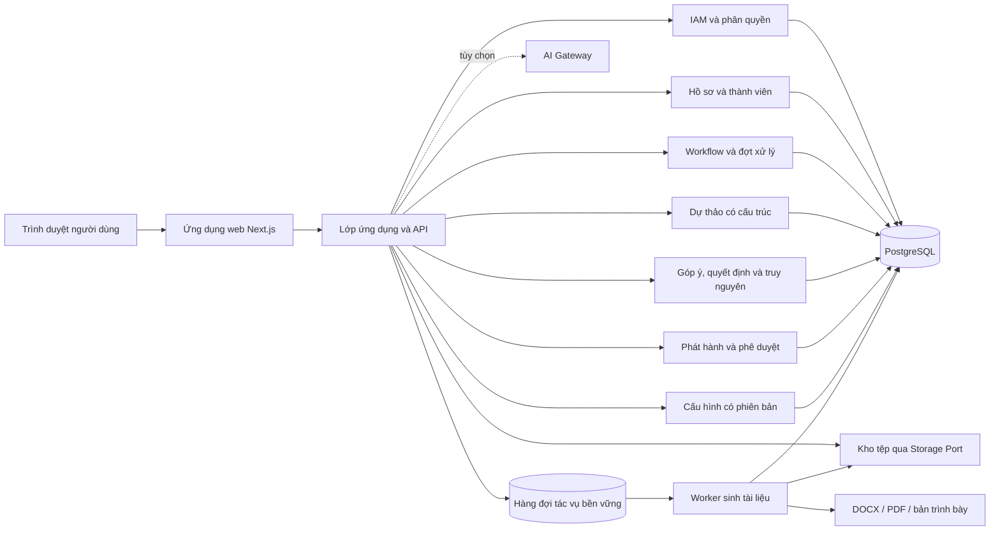

# Kiến trúc tổng thể

## 1. Trạng thái và phạm vi quyết định

- Mã công việc: `P0-02`.
- Trạng thái: baseline kiến trúc cho giai đoạn M2.
- Phạm vi: cấu trúc logic của ứng dụng, ranh giới mô-đun, luồng dữ liệu, cách triển khai ở mức khái niệm và các yêu cầu bắt buộc cho bước thiết kế dữ liệu/API tiếp theo.
- Chưa thuộc phạm vi: schema CSDL vật lý, hợp đồng API chi tiết, lựa chọn hệ thống lưu trữ tệp cụ thể, cấu hình container/NAS và tích hợp AI thật.

Kiến trúc này cụ thể hóa các nguyên tắc tại [phạm vi sản phẩm v1](../01-pham-vi-san-pham/pham-vi-phien-ban-1.md), [mô hình nghiệp vụ tổng thể](../03-phan-tich-nghiep-vu/mo-hinh-nghiep-vu-tong-the.md), [nguyên tắc workflow](../04-thiet-ke-quy-trinh/nguyen-tac-workflow.md) và [từ điển thực thể](../05-mo-hinh-du-lieu/tu-dien-thuc-the-nghiep-vu.md).

## 2. Mục tiêu kiến trúc

1. Structured Legal Editor là nguồn nội dung chính; bản truyền thống, DOCX và PDF là đầu ra có thể tái tạo.
2. Workflow, RuleSet và mẫu biểu được lưu dưới dạng cấu hình có phiên bản, không lập trình cứng vào giao diện hoặc mã điều hướng.
3. Workflow và phiên bản dự thảo là hai trục độc lập.
4. Mọi thay đổi đã chốt có thể truy nguyên đến căn cứ nghiệp vụ và người quyết định.
5. Hệ thống vận hành đầy đủ bằng thao tác thủ công khi AI bị tắt hoặc không khả dụng.
6. Phù hợp triển khai trên một NAS có tài nguyên hữu hạn nhưng không ràng buộc miền nghiệp vụ với một hãng NAS.
7. Bắt đầu bằng kiến trúc đơn giản, có ranh giới rõ để có thể tách tiến trình hoặc dịch vụ khi tải thực tế chứng minh cần thiết.

## 3. Lựa chọn kiến trúc

Hệ thống sử dụng **modular monolith TypeScript** cho phiên bản đầu:

- ứng dụng web Next.js cung cấp giao diện và lớp HTTP/BFF;
- các mô-đun nghiệp vụ chạy phía máy chủ, không đặt quy tắc quyết định chỉ ở React component;
- PostgreSQL là kho dữ liệu giao dịch chính;
- kho tệp được truy cập qua một cổng trừu tượng, triển khai ban đầu có thể là volume NAS hoặc dịch vụ tương thích S3 sau khi khảo sát;
- tiến trình worker tách biệt thực hiện sinh tài liệu và tác vụ nền;
- AI, nếu được bật sau M3, chỉ được gọi qua cổng tích hợp tùy chọn.

Không chọn microservice cho phiên bản đầu. Ranh giới mô-đun vẫn phải được duy trì trong mã và CSDL để tránh biến modular monolith thành một khối không phân lớp.

## 4. Sơ đồ thành phần logic



`AI Gateway` không nằm trên đường bắt buộc của thao tác thủ công. Mất AI không được làm gián đoạn lưu dự thảo, xử lý ý kiến, workflow hoặc xuất bản thủ công.

## 5. Các lớp kiến trúc

### 5.1. Lớp trình bày

- Next.js App Router và React.
- Hiển thị dữ liệu và trạng thái do lớp ứng dụng trả về.
- Có thể thực hiện validation trải nghiệm nhưng không phải nơi duy nhất bảo vệ bất biến nghiệp vụ.
- Không truy cập trực tiếp CSDL hoặc kho tệp từ client component.
- Không coi state React, HTML hoặc nội dung đã render là dữ liệu pháp lý nguồn.

### 5.2. Lớp ứng dụng

- Điều phối use case, transaction, phân quyền và ghi audit.
- Chuyển DTO thành lệnh nghiệp vụ và kết quả đọc.
- Bảo đảm thao tác quan trọng có idempotency hoặc kiểm soát phiên bản khi cần.
- Không chứa chi tiết trình bày DOCX/PDF.

### 5.3. Lớp miền nghiệp vụ

- Chứa bất biến và hành vi của hồ sơ, workflow, dự thảo, thay đổi, quyết định, phát hành và cấu hình.
- Không phụ thuộc Next.js, HTTP, trình điều khiển CSDL, kho tệp hay nhà cung cấp AI.
- Không suy đoán căn cứ pháp lý; chỉ thực thi cấu hình đã được xác nhận và công bố.

### 5.4. Lớp hạ tầng

- PostgreSQL, migration, repository adapter.
- Storage adapter cho tệp nguồn, tài liệu hỗ trợ và tài liệu sinh.
- Queue/worker adapter.
- Adapter định danh, audit, đồng hồ hệ thống và AI tùy chọn.

## 6. Ranh giới mô-đun

| Mô-đun | Trách nhiệm chính | Không được làm |
| --- | --- | --- |
| Identity & Access | User, Person, Organization, Role, membership, delegation và kiểm tra quyền | Không suy diễn thẩm quyền pháp lý chỉ từ vai trò kỹ thuật |
| Project | Hồ sơ, metadata, người tham gia và trạng thái vòng đời | Không sở hữu định nghĩa workflow hoặc nội dung dự thảo |
| Workflow | Definition/version/stage/instance, ReviewRound, cổng và chuyển bước | Không giới hạn số phiên bản dự thảo theo bước |
| Drafting | LegalDocument, LegalNode, workspace, checkpoint, version và branch | Không phát hành trực tiếp workspace/checkpoint |
| Review & Resolution | Consultation, Comment, ChangeProposal, ResolutionCase/Option/Decision | Không tự áp dụng đề xuất chưa được người có quyền quyết định |
| Traceability | LegalChange, DraftVersionBasis, đường phiên bản và audit liên quan thay đổi | Không lưu HTML diff làm nguồn |
| Amendment | SourceDocument đã kiểm chứng, AmendmentOperation và projection | Không biến projection thành văn bản hợp nhất chính thức |
| Release | ReleasePackage/Item, Submission, Approval và khóa phát hành | Không nhận workspace làm phương án dự thảo |
| Configuration | WorkflowVersion, RuleSet, template và căn cứ cấu hình có phiên bản | Không sửa tại chỗ bản đã công bố hoặc đã được sử dụng |
| Publishing | Tạo yêu cầu sinh, GeneratedDocument và metadata tái tạo | Không sửa nội dung nguồn trong lúc trình bày |
| Audit | Ghi sự kiện bất biến và mã tương quan | Không ghi bí mật hoặc toàn bộ nội dung nhạy cảm vào log |
| AI Gateway | Gửi dữ liệu đã được phép và nhận đề xuất có metadata | Không phê duyệt, tiếp thu, công bố cấu hình hoặc ghi đè bản chính |

Mô-đun giao tiếp qua application service và kiểu dữ liệu công khai. Không truy cập bảng nội bộ của mô-đun khác bằng logic tùy tiện.

## 7. Nguồn dữ liệu và lưu trữ

### 7.1. PostgreSQL

PostgreSQL lưu:

- dữ liệu giao dịch và quan hệ giữa thực thể;
- nội dung pháp lý có cấu trúc;
- phiên bản, trạng thái, quyết định và liên kết truy nguyên;
- metadata tệp, checksum và trạng thái kiểm chứng;
- cấu hình workflow, RuleSet và template có phiên bản;
- audit event cần truy vấn nghiệp vụ.

Schema vật lý được thiết kế tại P0-04. Việc dùng cột quan hệ, JSONB hoặc kết hợp phải được quyết định theo từng nhóm dữ liệu; không mặc định lưu toàn bộ miền nghiệp vụ trong một blob JSON.

### 7.2. Kho tệp

Kho tệp lưu binary của `SourceDocument`, `SupportingDocument` và `GeneratedDocument`. CSDL chỉ lưu metadata, định danh, checksum, kích thước, media type, storage key và quan hệ nghiệp vụ.

Ứng dụng dùng `StoragePort`, tối thiểu gồm:

- ghi tệp theo storage key do hệ thống cấp;
- đọc theo quyền;
- kiểm tra tồn tại và checksum;
- tạo phiên bản mới thay vì ghi đè binary đã được tham chiếu;
- xóa theo chính sách lưu giữ được phê duyệt, không xóa ngầm.

Chọn volume NAS hay S3-compatible adapter được hoãn đến P4-01/P4-02.

### 7.3. Hàng đợi tác vụ

Tác vụ nền phải bền vững qua khởi động lại. Phiên bản đầu ưu tiên bảng job trong PostgreSQL và worker polling có khóa tranh chấp, tránh thêm message broker trước khi có nhu cầu tải thực tế.

Job tối thiểu ghi loại, input bất biến, trạng thái, số lần thử, lỗi đã giảm thiểu dữ liệu nhạy cảm, thời điểm và kết quả. Sinh lại tài liệu tạo kết quả mới, không thay thế tài liệu đã nằm trong gói phát hành.

## 8. Các luồng dữ liệu quan trọng

### 8.1. Lưu workspace

1. Client gửi nội dung cấu trúc và revision đang biết.
2. API xác thực tài khoản, membership, quyền nhánh/nút và khóa mềm khi áp dụng.
3. Domain kiểm tra bất biến cấu trúc tối thiểu.
4. Transaction cập nhật workspace bằng optimistic concurrency.
5. Audit ghi người thực hiện, revision trước/sau và mã tương quan.
6. API trả revision máy chủ; client chỉ hiển thị “đã đồng bộ” sau phản hồi này.

### 8.2. Tạo DraftVersion

1. Kiểm tra workspace đã đồng bộ, quyền và lỗi chặn.
2. Khóa snapshot dữ liệu cấu trúc, RuleSet version, nhánh, cha/nguồn hợp nhất và căn cứ.
3. Tạo `DraftVersion` bất biến trong transaction.
4. Ghi checkpoint và audit theo chính sách.
5. Workspace tiếp tục từ mốc mới; không biến `DraftVersion` thành bản có thể sửa.

### 8.3. Phát hành gói

1. Chỉ chọn `DraftVersion` và tài liệu đúng loại.
2. Chạy cổng workflow và RuleSet đã gán.
3. Người có quyền xác nhận cảnh báo/ngoại lệ và phê duyệt.
4. Khóa `ReleasePackage` cùng item và metadata đầu ra.
5. Thay đổi sau đó tạo gói mới.

### 8.4. Sinh DOCX/PDF

1. Application tạo job từ `DraftVersion`, RuleSet version và template version bất biến.
2. Worker đọc snapshot và sinh đầu ra trong vùng làm việc tạm.
3. Worker kiểm tra kết quả tối thiểu, tính checksum và ghi binary qua StoragePort.
4. Transaction tạo `GeneratedDocument` cùng metadata tái tạo.
5. Lỗi không làm thay đổi nội dung nguồn hoặc trạng thái phê duyệt.

## 9. Giao diện API

API chi tiết được thiết kế tại P0-03/P0-05. Baseline bắt buộc:

- route có version, ví dụ `/api/v1/...`;
- request/response có schema validation dùng chung;
- mã lỗi ổn định, thông điệp tiếng Việt ở lớp trình bày;
- optimistic concurrency cho tài nguyên có thể sửa;
- idempotency key cho thao tác có nguy cơ gửi lặp như tạo version, phát hành và tạo job;
- pagination/filtering cho danh sách;
- không trả storage path nội bộ hoặc bí mật;
- mọi thao tác thay đổi trạng thái quan trọng ghi audit trong cùng transaction hoặc cơ chế bảo đảm tương đương.

## 10. Bảo mật và quyền

- Xác thực và phân quyền là hai bước riêng.
- Quyền được đánh giá theo người dùng, membership, vai trò, delegation, hồ sơ, nhánh, trạng thái và thời gian.
- Backend là điểm thực thi quyền cuối cùng; ẩn nút ở frontend không đủ.
- Tệp chỉ được tải qua endpoint kiểm tra quyền hoặc URL tạm thời có thời hạn nếu adapter hỗ trợ.
- Log giảm thiểu nội dung pháp lý, dữ liệu cá nhân và thông tin tệp.
- Secrets chỉ đi qua cấu hình môi trường hoặc secret store được phê duyệt.
- Dữ liệu thật không được dùng trong seed, test fixture hoặc Git.

Chi tiết IAM, phân loại dữ liệu, retention và threat model thuộc P0-06/P0-10.

## 11. Khả năng triển khai và mở rộng

### 11.1. Các tiến trình logic

| Tiến trình | Vai trò | Có thể chạy chung máy |
| --- | --- | --- |
| Web | UI, API và application service | Có |
| Worker | Sinh tài liệu và tác vụ nền | Có, nhưng giới hạn CPU/RAM riêng |
| PostgreSQL | Dữ liệu giao dịch | Có trong pilot nếu NAS đáp ứng và có backup phù hợp |
| File storage | Binary và đầu ra | Có trên volume NAS hoặc dịch vụ tách biệt |

Các tiến trình có thể đóng gói riêng dù thuộc cùng modular monolith. Không chạy OCR nặng, huấn luyện mô hình hoặc xử lý PDF hàng loạt trên NAS.

### 11.2. Điều kiện xem xét tách dịch vụ

Chỉ tách khi có bằng chứng về ít nhất một trong các nhu cầu:

- scale worker độc lập do tải xuất bản;
- vùng tin cậy/bảo mật khác biệt;
- chu kỳ triển khai độc lập có giá trị rõ;
- giới hạn công nghệ không thể giải quyết trong monolith;
- số liệu vận hành chứng minh nghẽn hoặc ảnh hưởng ổn định.

Việc tách không được làm mất transaction, truy nguyên hoặc khả năng vận hành thủ công.

## 12. Yêu cầu phi chức năng baseline

| Nhóm | Yêu cầu baseline |
| --- | --- |
| Tính đúng | Bất biến miền nghiệp vụ được kiểm tra ở server và CSDL khi có thể |
| Truy nguyên | Thao tác quan trọng có audit và mã tương quan |
| Khôi phục | DB và tệp có backup đồng bộ; quy trình phục hồi được thử trước pilot |
| Hiệu năng | Thao tác tương tác không chờ job xuất bản; danh sách có pagination |
| Đồng thời | Optimistic concurrency; không ghi đè âm thầm workspace hoặc quyết định |
| Khả dụng | Luồng thủ công không phụ thuộc AI; job có retry hữu hạn và quan sát được |
| Quan sát | Health check, structured log, metric job/lỗi/dung lượng; không lộ dữ liệu nhạy cảm |
| Kiểm thử | Unit miền, integration DB/API, contract và end-to-end cho luồng trọng yếu |
| Khả năng thay thế | Storage, AI và định danh đi qua port/adapter |

Giá trị định lượng về tải, thời gian đáp ứng, RPO và RTO chỉ được chốt sau khảo sát NAS và nhu cầu người dùng.

## 13. Cấu trúc mã đề xuất cho M2

```text
app/
  web/                    # Next.js UI và HTTP/BFF
packages/
  contracts/              # DTO và schema validation có phiên bản
  domain/                 # Kiểu miền và bất biến, không phụ thuộc framework
  application/            # Use case, transaction boundary, authorization
  infrastructure/         # PostgreSQL, storage, queue, identity adapters
  publishing/             # Renderer và worker sinh tài liệu
  testing/                # Fixture giả lập, factory và helper kiểm thử
```

Cấu trúc thực tế có thể bắt đầu gọn hơn, nhưng chiều phụ thuộc phải đi từ presentation/infrastructure vào application/domain, không theo chiều ngược lại.

## 14. Quyết định đã chốt và nội dung còn hoãn

### 14.1. Đã chốt cho baseline

- Modular monolith thay vì microservice.
- TypeScript xuyên suốt web, application và domain ở phiên bản đầu.
- PostgreSQL là nguồn dữ liệu giao dịch chính.
- Binary tách khỏi CSDL và truy cập qua StoragePort.
- Worker tách tiến trình cho sinh tài liệu/tác vụ nền.
- Job bền vững ưu tiên dùng PostgreSQL trước khi bổ sung broker.
- API có version và validation schema.
- Domain không phụ thuộc Next.js, storage hoặc AI provider.
- AI là adapter tùy chọn ngoài đường bắt buộc.

### 14.2. Hoãn đến bước có đủ thông tin

| Nội dung | Bước quyết định | Thông tin cần có |
| --- | --- | --- |
| Query layer/ORM | P0-05 | SQL migration P0-04 là nguồn chuẩn; cần use case API thực tế để chọn lớp truy vấn |
| Thư viện validation/API contract | P0-03/P0-05 | Cách chia package và client generation |
| Volume NAS hay S3-compatible storage | P4-01/P4-02 | Loại NAS, quyền file, backup, network |
| Cơ chế xác thực/danh bạ | P0-06 | Hệ thống định danh hiện có của cơ quan |
| RPO/RTO, tải và dung lượng | P4-01/P4-07 | Số người dùng, kích thước hồ sơ, SLA |
| Nhà cung cấp và vị trí xử lý AI | P3-01 | Chính sách dữ liệu và phê duyệt bảo mật |

## 15. Tiêu chí nghiệm thu P0-02

- [x] Có lựa chọn kiến trúc và lý do.
- [x] Có sơ đồ thành phần và chiều phụ thuộc.
- [x] Có ranh giới mô-đun nghiệp vụ.
- [x] Có nguồn dữ liệu chính và ranh giới lưu tệp.
- [x] Có luồng workspace, version, phát hành và sinh tài liệu.
- [x] Có nguyên tắc API, bảo mật, audit và tác vụ nền.
- [x] AI không nằm trên đường bắt buộc.
- [x] Có chiến lược triển khai logic phù hợp NAS và điều kiện tách dịch vụ.
- [x] Các quyết định chưa đủ dữ liệu được hoãn có chủ đích, không suy đoán.

P0-03 đã chuyển baseline này thành [hợp đồng dữ liệu cấu trúc phiên bản 1.0](hop-dong-du-lieu-cau-truc.md). P0-04 tiếp tục ánh xạ hợp đồng sang schema CSDL vật lý.
