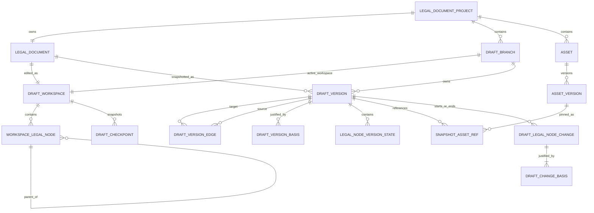

# Thiết kế cơ sở dữ liệu

## 1. Trạng thái và phạm vi

- Mã công việc: `P0-04`.
- Hệ quản trị: PostgreSQL.
- Migration: [`packages/database/migrations`](../../packages/database/migrations/0001_p0_04_foundation.sql).
- Phạm vi: nền dữ liệu cho hồ sơ tối thiểu, Structured Legal Editor, nhánh, workspace, checkpoint, version, căn cứ, thay đổi và asset phiên bản 1.1.
- Chưa thuộc phạm vi: schema IAM đầy đủ, workflow, góp ý/quyết định, ReleasePackage, GeneratedDocument, cấu hình RuleSet thực tế và API.

Thiết kế này ánh xạ [hợp đồng dữ liệu cấu trúc](hop-dong-du-lieu-cau-truc.md) và [hợp đồng bảng/hình](hop-dong-du-lieu-da-phuong-tien.md) sang mô hình vật lý. Interface TypeScript không được biến máy móc thành đúng một bảng; dữ liệu được chuẩn hóa hoặc snapshot tùy vòng đời và nhu cầu tái tạo.

## 2. Quyết định lưu trữ

### 2.1. Mô hình lai

| Loại dữ liệu | Cách lưu | Lý do |
| --- | --- | --- |
| Hồ sơ, nhánh, version, cạnh version, căn cứ | Bảng quan hệ | Khóa, transaction, truy vấn và ràng buộc |
| Workspace node hiện hành | Bảng quan hệ + JSONB cho content blocks | Cập nhật/truy vấn nút độc lập nhưng giữ block có cấu trúc |
| Checkpoint và DraftVersion | Snapshot JSONB + SHA-256 | Tái tạo chính xác contract payload tại mốc bất biến |
| LegalNode tại version | Bảng trạng thái tách riêng | So sánh xa và ánh xạ bằng ID ổn định |
| Trạng thái trước/sau của thay đổi | JSONB | Giữ đúng contract state và lịch sử |
| Asset binary | Ngoài PostgreSQL | Không làm phình backup giao dịch; do StoragePort quản lý |
| Asset metadata và liên kết snapshot | Bảng quan hệ | Bảo đảm đúng asset version/checksum và truy vấn tác động |

Snapshot JSONB không thay thế các bảng quan hệ. Nó là bản đóng gói bất biến phục vụ tái tạo, export và kiểm tra checksum.

### 2.2. ID và thời gian

- ID dùng PostgreSQL `uuid`, do application cấp.
- Migration không yêu cầu extension sinh UUID.
- Tất cả thời điểm dùng `timestamptz`.
- Actor ID được lưu riêng theo user/person/membership/delegation. P0-06 đã bổ sung schema IAM và enforcement ở API; các cột actor lịch sử chưa được thêm FK hàng loạt cho tới khi có migration đối chiếu dữ liệu hiện hữu.
- Mã nghiệp vụ cấu hình dùng `text`; không dùng PostgreSQL enum để tránh migration khóa cứng danh mục.

### 2.3. Phiên bản hợp đồng

Các snapshot hiện nhận `contract_version` là `1.0` hoặc `1.1`. Nâng major phải có migration/adapter rõ ràng; không sửa JSON cũ tại chỗ.

## 3. ERD nền

## 4. Các nhóm bảng

### 4.1. Hồ sơ và văn bản

| Bảng | Vai trò |
| --- | --- |
| `legal_document_project` | Hồ sơ xuyên suốt vòng đời, chưa bao gồm membership/workflow |
| `legal_document` | Định danh nội dung pháp lý logic thuộc hồ sơ |

Mỗi hồ sơ hiện có tối đa một `legal_document`. Khi nghiệp vụ xác nhận một hồ sơ cần nhiều văn bản logic, constraint này phải được thay bằng migration mới, không bỏ âm thầm.

### 4.2. Nhánh và workspace

| Bảng | Vai trò |
| --- | --- |
| `draft_branch` | Phương án nội dung, điểm tách và trạng thái đóng/hợp nhất |
| `draft_workspace` | Workspace duy nhất đang hoạt động trên nhánh, có revision |
| `workspace_legal_node` | Cây nội dung hiện hành dạng danh sách phẳng |

Quan hệ cha trong `workspace_legal_node` là FK ghép `(workspace_id, parent_node_id)`, deferred để cho phép sắp thứ tự insert trong cùng transaction. Unique index dùng `coalesce` để kiểm soát `order_key` cả ở cấp gốc.

### 4.3. Checkpoint và version

| Bảng | Vai trò |
| --- | --- |
| `draft_checkpoint` | Snapshot khôi phục bất biến của workspace revision |
| `draft_version` | Mốc dự thảo bất biến, có snapshot, RuleSet và người chốt |
| `draft_version_edge` | Cha trực tiếp hoặc nguồn hợp nhất |
| `draft_version_basis` | Một hoặc nhiều căn cứ tạo version |
| `legal_node_version_state` | Trạng thái nút tại version để so sánh |

Constraint trigger deferred bảo đảm mỗi version có ít nhất một căn cứ sau khi transaction hoàn thành. Cạnh version phải nằm trong cùng hồ sơ và không tạo chu trình. Mỗi version có tối đa một cạnh `PARENT`, nhưng có thể có nhiều `MERGE_SOURCE`.

### 4.4. Thay đổi và truy nguyên

| Bảng | Vai trò |
| --- | --- |
| `draft_legal_node_change` | Biến động của cùng LegalNode giữa hai DraftVersion |
| `draft_change_basis` | Ít nhất một nguồn nghiệp vụ cho thay đổi |

`before_state`/`after_state` lưu contract JSON object; mã thay đổi tách rõ thêm, bỏ, đổi số, di chuyển, sửa nội dung và di chuyển kèm sửa nội dung.

Migration hiện chưa có constraint trigger bắt buộc `draft_change_basis` vì use case thay đổi sẽ được hoàn thiện cùng Review & Resolution. Application P0-05 phải insert change và basis trong cùng transaction; migration tiếp theo sẽ bổ sung constraint deferred khi schema nguồn nghiệp vụ được tạo.

### 4.5. Asset và hình

| Bảng | Vai trò |
| --- | --- |
| `asset` | Định danh logic của tài sản trong hồ sơ |
| `asset_version` | Binary version bất biến, metadata, checksum và storage key nội bộ |
| `snapshot_asset_ref` | Hình tại một DraftVersion, ghim đúng asset version |

FK ghép `(asset_version_id, asset_id)` ngăn tham chiếu một version thuộc asset khác. FK `(draft_version_id, legal_node_id)` bảo đảm hình thuộc một node có trong projection của chính version đó. `snapshot_asset_ref` lưu alternative text, caption, source, verification status và display role để truy vấn mà không phải quét toàn snapshot.

Binary không nằm trong CSDL. `storage_key` chỉ thuộc hạ tầng, không xuất hiện trong hợp đồng public hoặc audit payload.

## 5. Bất biến được CSDL bảo vệ

- Mã hồ sơ và mã version không trùng trong phạm vi tương ứng.
- Mỗi nhánh có tối đa một workspace.
- Checkpoint phải thuộc đúng nhánh của workspace; version chỉ được dùng checkpoint cùng nhánh.
- Revision workspace chỉ tăng đúng một mỗi lần cập nhật workspace row.
- Parent node thuộc cùng workspace/version.
- Nút không tự làm cha của nó.
- `order_key` không trùng giữa các nút cùng cha.
- Content blocks là JSON array; metadata và snapshot là JSON object.
- Checkpoint, DraftVersion, version edge/basis/state, change, asset version và snapshot asset ref không cho sửa/xóa.
- DraftVersion bắt buộc có ít nhất một basis khi transaction hoàn tất.
- Version edge không tự trỏ, không vượt hồ sơ và không tạo chu trình.
- Mỗi version có tối đa một parent chính.
- Asset version có version number dương, checksum SHA-256 và storage key duy nhất.
- Snapshot figure ghim đúng project, node và asset/version; checksum đúng định dạng và alternative text không rỗng.

## 6. Bất biến thuộc application/domain

CSDL chưa hoặc không nên tự quyết định:

- quyền của actor tại thời điểm thao tác;
- quy tắc cha-con và đánh số theo RuleSet;
- cây không có chu trình nhiều cấp ở workspace node;
- checksum snapshot từ canonical JSON;
- snapshot JSON khớp hoàn toàn các hàng projection/node state;
- revision workspace phải được tăng cùng transaction với thay đổi node;
- version code tuần tự theo chính sách hồ sơ;
- source basis tồn tại và đủ điều kiện nghiệp vụ;
- DraftChange có basis hợp lệ cho tới khi schema Review & Resolution hoàn thành;
- MIME thực tế, quét an toàn và checksum binary;
- checksum/media type/byte size trong snapshot asset ref phải khớp metadata của asset version;
- alternative text/caption đáp ứng RuleSet/template.

Các điểm này phải có test application/integration; không được coi việc insert thành công là phê duyệt nghiệp vụ.

## 7. Tính bất biến và sửa sai

Trigger `reject_immutable_change` chặn `UPDATE`/`DELETE` trên dữ liệu đã đóng dấu. Sửa sai được thực hiện bằng bản ghi thay thế hoặc version mới, không tắt trigger trong luồng ứng dụng.

Migration quản trị đặc biệt nếu thực sự cần sửa dữ liệu phải:

1. có quyết định và phạm vi rõ;
2. backup trước khi chạy;
3. chạy trong maintenance window;
4. ghi đối chiếu trước/sau và audit bên ngoài migration;
5. được kiểm thử trên bản sao dữ liệu;
6. không sửa trực tiếp hệ thống NAS đang vận hành bằng thao tác thủ công.

## 8. Migration và rollback

- Migration là forward-only và chạy trong transaction khi PostgreSQL cho phép.
- Không dùng `DROP ... CASCADE` trong migration vận hành thông thường.
- Rollback release ưu tiên quay lại artifact tương thích schema; không tự động hạ schema nếu có nguy cơ mất dữ liệu.
- Migration destructive trong tương lai phải dùng chiến lược expand–migrate–contract và có phiên bản backup/phục hồi.
- Tệp `0002_p0_04_test_fixture.sql` luôn `ROLLBACK`, chỉ kiểm tra ràng buộc bằng dữ liệu giả định.

Runner migration, bảng theo dõi migration và advisory lock triển khai sẽ được bổ sung cùng backend P0-05/P4-03.

## 9. Chỉ mục baseline

- Tra version theo hồ sơ và thời điểm chốt.
- Tra checkpoint theo workspace và thời điểm.
- Duyệt cây workspace/version theo parent và order.
- Tra thay đổi theo project, LegalNode và thời điểm quyết định.
- Tra basis theo version hoặc nguồn.
- Tra các snapshot đang tham chiếu asset version.

Chỉ mục tìm kiếm nội dung, full-text và JSONB GIN chỉ được thêm sau khi có query thực tế; không tạo chỉ mục lớn theo suy đoán.

## 10. Kiểm thử migration

Fixture kiểm tra:

- insert hồ sơ, document, branch, workspace và LegalNode;
- revision hợp lệ tăng `0 → 1`;
- revision nhảy `1 → 3` bị chặn;
- tạo checkpoint và DT-005/DT-006 với basis;
- tạo cạnh parent hợp lệ;
- ghim asset version vào figure của DT-006;
- sửa DraftVersion bất biến bị chặn;
- constraint deferred được kích hoạt trước rollback;
- toàn bộ dữ liệu fixture được rollback.

Máy phát triển hiện chưa có PostgreSQL client/server trong PATH, nên lượt triển khai này kiểm tra tĩnh migration. Việc chạy thật `0001` + `0002` trên PostgreSQL tương thích là điều kiện bắt buộc trước khi tích hợp backend hoặc đóng gói.

## 11. Nội dung còn hoãn

- Phiên bản PostgreSQL tối thiểu theo NAS mục tiêu.
- Migration runner/query layer; SQL migration là nguồn chuẩn ở P0-04.
- Schema IAM và FK actor.
- Workflow, ReviewRound, Comment/Resolution, ReleasePackage và audit đầy đủ.
- GeneratedDocument và publishing job.
- Retention, soft delete/archival và partitioning.
- Full-text search và báo cáo.
- Row-level security; backend authorization vẫn là bắt buộc dù sau này có RLS.
- Storage adapter và chính sách cách ly/quét tệp.

## 12. Tiêu chí nghiệm thu P0-04

- [x] Có ERD và chiến lược ánh xạ contract → PostgreSQL.
- [x] Có migration transaction cho schema nền.
- [x] Không cần extension sinh UUID.
- [x] Workspace, checkpoint và version được phân biệt.
- [x] Có graph parent/merge source và kiểm tra không chu trình.
- [x] DraftVersion bắt buộc có basis.
- [x] Có trạng thái LegalNode tại version và thay đổi truy nguyên.
- [x] Có asset/version và snapshot figure ghim đúng binary version.
- [x] Binary không lưu trong PostgreSQL.
- [x] Bảng bất biến bị chặn sửa/xóa.
- [x] Có fixture giả định rollback để kiểm tra ràng buộc.
- [ ] Chạy migration thật trên PostgreSQL tương thích — chờ môi trường database ở P0-05/P4-01.

P0-04 hoàn thành thiết kế và migration nguồn; trạng thái nghiệm thu vận hành vẫn chờ kiểm thử PostgreSQL thật.
